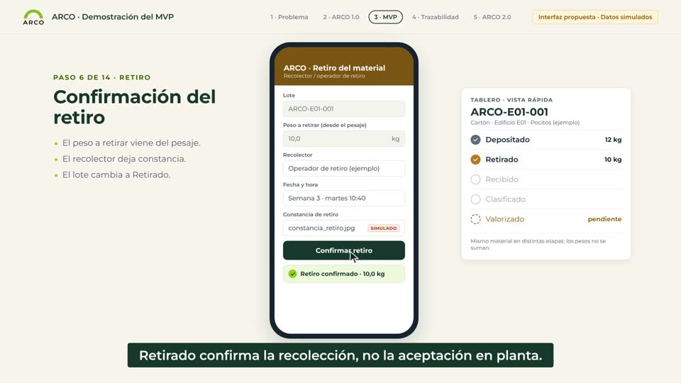

<p align="center">
  
</p>

<h1 align="center">ARCO · Acelerador de Reciclaje Colaborativo en Origen</h1>

<p align="center">
  <strong>Sitio web v2.0 · Entrega final 2026</strong><br>
  Diplomado en Gobernabilidad e Innovación Pública · CAF – Universidad de Montevideo
</p>

<p align="center">
  <a href="https://arco-um-caf.github.io/"><strong>Sitio público</strong></a> ·
  <a href="https://arco-um-caf.github.io/index.html#videos">Videos</a> ·
  <a href="documentos/2026-11-23_brief-arco-definitivo.pdf">Brief definitivo (PDF)</a> ·
  <a href="ROADMAP.md">Hoja de ruta</a> ·
  <a href="CONTRIBUTING.md">Cómo contribuir</a>
</p>

---

## Descripción ejecutiva

ARCO es un proyecto «puente» de innovación pública para acelerar la circularidad en la gestión de residuos urbanos de Montevideo. Propone un **servicio piloto colaborativo de bajo costo** en un edificio, que coordina a residentes, administración, referente, recolector y gestor, y que registra con evidencia el recorrido del material desde la separación en origen hasta su valorización.

El edificio funciona como unidad de microgobernanza, la trazabilidad como mecanismo de confianza y el pesaje como puente entre el aprendizaje local y la política pública.

## Contexto institucional y académico

Proyecto de equipo desarrollado en el marco del **Diplomado en Gobernabilidad e Innovación Pública de CAF y la Universidad de Montevideo** (2026). El equipo realizó su entrega formal en noviembre de 2026. Este repositorio y su sitio son un recurso complementario para el comité evaluador, posibles aliados, financiadores y colaboradores técnicos.

La mención de CAF y de la Universidad de Montevideo indica el contexto académico y no implica un aval institucional adicional.

## Problema

- El 51 % de los montevideanos se declara insatisfecho con la recolección de residuos (Equipos Consultores, 2026).
- En las cuatro plantas de clasificación, no más del 43 % del material recibido como reciclable llega a venderse a la industria; el resto termina en el Sitio de Disposición Final Felipe Cardoso.
- En una encuesta exploratoria propia a 111 hogares, el 23,4 % dice separar siempre y el 45,9 % dejó de separar alguna vez.

Cadena actual: separación deficiente → recolección fija → reciclaje mínimo → vertido mayoritario a disposición final.

## Propuesta de valor

ARCO no sustituye al programa Hogares Sustentables de la Intendencia de Montevideo: agrega una capa de **comportamiento, coordinación y trazabilidad** para mejorar la calidad de la separación y demostrar con cifras cuánto material llega a valorizarse. Seis vectores: microgobernanza edilicia, roles colaborativos, trazabilidad por estados verificables, integración con la política pública, kit modular replicable y visión de largo plazo hacia «Vertedero Cero».

## Alcance del MVP (ARCO 1.0)

| Elemento | Definición en el brief definitivo |
|---|---|
| Unidad | 1 edificio típico de Montevideo, mínimo 20 apartamentos (Pocitos) |
| Material | 1 (máximo 2), por ejemplo plástico o cartón |
| Duración | Semanas 1–2 de kick-off y línea de base, 3–8 de operación, cierre en la 9 |
| Actores | Residentes, referente ARCO, administración, personal del edificio, recolector, gestor o planta, IM, equipo ARCO |
| Trazabilidad | Depositado → Retirado → Recibido → Clasificado → Valorizado, cada estado con su evidencia |
| Meta | +20 % de material valorizado frente a la línea de base |
| Presupuesto | USD 890–1.330 (estimado) |

<p align="center">
  <br>
  <em>Demostración del MVP: acreditación de la valorización. Datos simulados.</em>
</p>

## ARCO 1.0 y ARCO 2.0

| | ARCO 1.0 | ARCO 2.0 |
|---|---|---|
| Naturaleza | MVP y piloto propuesto | Proyección conceptual, sujeta a validación |
| Escala | 1 edificio | +5 edificios (luego 3.0: +25; 4.0: +100) |
| Tecnología | Manual: balanza, planillas, stickers, WhatsApp | Se evaluaría: app móvil, estaciones modulares, sensores, pesaje digital, automatización y datos centralizados |
| Estado | Diseñado, no ejecutado | No desarrollado, no financiado, no validado |

> No confundir **ARCO 2.0** (posible evolución del proyecto) con la **versión 2.0 del sitio web** (`web-v2.0.0`).

## Estado actual del proyecto

| Componente | Estado |
|---|---|
| Brief definitivo | Entregado (23/11/2026) |
| Sitio web público | Versión 2.0 publicada en GitHub Pages |
| Video institucional | Publicado (5:00) |
| Demostración del MVP | Video con datos simulados (3:49). No es un sistema en producción |
| Aplicación funcional / backend | **No existe.** Pendiente de desarrollo |
| Piloto | Propuesto, no ejecutado. Sin compromisos formales documentados de gestores, plantas ni de la IM |

## Enlaces

- Sitio: <https://arco-um-caf.github.io/>
- Video institucional, «ARCO | Presentación del proyecto»: [ver en el sitio](https://arco-um-caf.github.io/index.html#videos) · [descargar MP4](assets/video/arco-presentacion.mp4)
- Video «ARCO 1.0 | Demostración del MVP»: [ver en el sitio](https://arco-um-caf.github.io/mvp.html) · [descargar MP4](assets/video/arco-demo-mvp.mp4)
- Versión original en alta calidad del video institucional: archivo adjunto de la [release `web-v2.0.0`](https://github.com/arco-um-caf/arco-um-caf.github.io/releases)
- Brief definitivo: [`documentos/2026-11-23_brief-arco-definitivo.pdf`](documentos/2026-11-23_brief-arco-definitivo.pdf)
- QR directo al sitio: [`assets/qr/arco-qr-sitio-directo.svg`](assets/qr/arco-qr-sitio-directo.svg)

## Estructura del repositorio

```
index.html              Portada: qué es ARCO, videos, piloto, evaluación, etapas, colaboración
propuesta.html          El proyecto: desafío, fundamentación, indicadores, actores, cronograma, presupuesto
investigacion.html      Encuesta exploratoria y devoluciones
mvp.html                Demostración del MVP y sus 14 pasos
desarrollo.html         Evolución: ARCO 1.0 / 2.0, del prototipo a la implementación, desarrollo abierto
documentos.html         Brief definitivo, videos, QR y antecedentes históricos
equipo.html             Integrantes
recorrido.html          Historia del proyecto
galeria.html            Fotografías y piezas
404.html                Página para enlaces rotos
assets/css, js, fonts   Estilos, script y tipografía local (Montserrat, SIL OFL)
assets/img              Logo, equipo, capturas, proceso y piezas
assets/video            Videos web (MP4 H.264/AAC), portadas y subtítulos
assets/qr               QR directo (PNG, SVG) y QR de la entrega
documentos/             PDF, CSV y TXT publicables
herramientas/           comunes.py: regenera cabecera y pie en todas las páginas
docs/tecnica/           Reservado para documentación técnica del desarrollo funcional
docs/historial/         Inventario, verificaciones y guía de la versión 1
src/, tests/            Reservados para el código y las pruebas de la aplicación (vacíos)
```

## Tecnologías efectivamente utilizadas

- HTML5, CSS3 y JavaScript sin frameworks ni dependencias externas.
- Tipografía Montserrat alojada localmente.
- GitHub Pages (publicación desde la rama `main`, carpeta raíz).
- Python 3, solo para el script de mantenimiento `herramientas/comunes.py`.
- ffmpeg, usado fuera del repositorio para generar la versión web del video institucional.

No hay base de datos, API, backend ni servicios de terceros.

## Ejecutar el sitio localmente

```bash
git clone https://github.com/arco-um-caf/arco-um-caf.github.io.git
cd arco-um-caf.github.io
python3 -m http.server 8000
# abrir http://localhost:8000
```

Para cambiar el menú o el pie de página en todas las páginas a la vez, editá las plantillas de `herramientas/comunes.py` y ejecutá:

```bash
python3 herramientas/comunes.py
```

## Para posibles colaboradores

El paso siguiente es el **desarrollo funcional** de la herramienta del piloto, no del sitio. Las pantallas y estados de la demostración funcionan como especificación visual. Ver:

- [`ROADMAP.md`](ROADMAP.md): hoja de ruta y oportunidades de desarrollo.
- [`DOCUMENTACION_TECNICA.md`](DOCUMENTACION_TECNICA.md): requisitos y modelo de datos **propuestos**.
- [`CONTRIBUTING.md`](CONTRIBUTING.md): cómo proponer mejoras.

## Hoja de ruta tecnológica (resumen)

Diseño conceptual ✅ → MVP demostrativo ✅ → Desarrollo funcional → Pruebas y validación → Piloto → Evaluación → Escalabilidad. Sin plazos comprometidos. Detalle en [`ROADMAP.md`](ROADMAP.md).

## Equipo

| Integrante | Formación y cargo |
|---|---|
| María Arbilla | Licenciada en Comunicación · Corte Electoral |
| Sebastián Arbifeuille | Contador · División Gestión de Procesos, MTOP |
| Sebastián Arballo | Analista en Comunicación Corporativa y RR. PP. · Corte Electoral · Agencia SYNOVA |
| Yuri Martín Biardo | Tecnólogo Industrial · Director de Compras de Mantenimiento, División Limpieza, Intendencia de Montevideo |
| María Andrea Catalá Pezzatti | Doctora en Derecho · Téc. Profesional IMPO (Diario Oficial) · Especialista en DD. HH. y Políticas Sociales |
| Sara Ilha | Doctora en Derecho · Asesora jurídica, Presidencia de la República |
| Pablo Vieytes | Arquitecto IXOU · Diploma en Arquitectura Sostenible · Premio Nacional de Eficiencia Energética |

## Historial de versiones

| Versión del sitio | Fecha | Descripción |
|---|---|---|
| `web-v2.0.0` | Noviembre 2026 | Entrega final: brief definitivo, dos videos en portada, nueva navegación, ARCO 1.0 / 2.0, desarrollo abierto |
| v1 (sin etiqueta) | Noviembre 2026 | Portal documental inicial |

Detalle en [`CHANGELOG.md`](CHANGELOG.md).

## Derechos

El equipo todavía no asignó una licencia de reutilización para los contenidos ni para el código; hasta que lo haga, no se otorga ninguna licencia. La tipografía Montserrat se distribuye bajo su propia licencia SIL Open Font License ([`assets/fonts/OFL-Montserrat.txt`](assets/fonts/OFL-Montserrat.txt)).
